### Digital QR menus for restaurants

*Ofrece a tus clientes una forma rápida y sencilla de consultar tu menú desde su celular.*

## How it works

| 1. Edit | 2. Place | 3. Scan |
| :-- | :-- | :-- |
| Owners manage their restaurants and menus in the [portal](https://portal.qartaonline.com). | A QR code goes on every table. | Customers scan it and the live menu opens on [qartaonline.com](https://qartaonline.com), right on their phone. |

## Contact

📬 [contacto@qartaonline.com](mailto:contacto@qartaonline.com) · 📸 [@qartaonline](https://www.instagram.com/qartaonline/)
